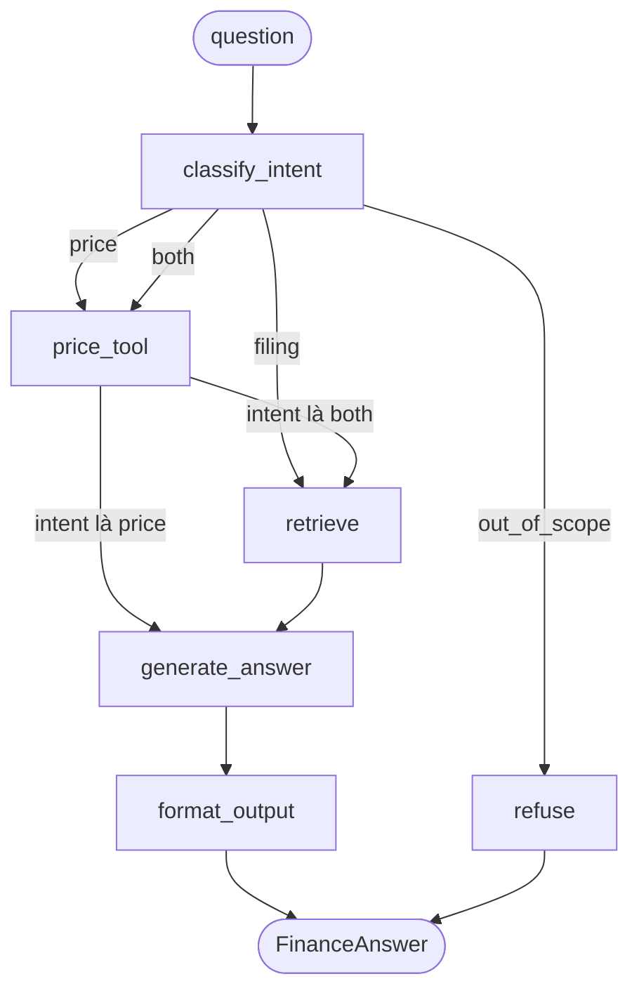

# FinAssist (`finassist`)

A LangGraph assistant for AAPL, MSFT and NVDA: it routes a question to a stock price tool, a Chroma retriever over 10-K filings, or a refusal, and returns a validated `FinanceAnswer` with citations.

FinAssist là trợ lý AI tài chính cho ba công ty Apple (AAPL), Microsoft (MSFT) và NVIDIA (NVDA). Câu hỏi về nội dung báo cáo 10-K được trả lời bằng RAG trên kho Chroma cục bộ, kèm trích dẫn `chunk_id`. Câu hỏi về giá, vốn hóa và P/E được trả lời bằng một công cụ tất định gọi yfinance. Kết quả là một đối tượng JSON có cấu trúc (`FinanceAnswer`). Câu hỏi ngoài phạm vi, kể cả xin tư vấn đầu tư, bị từ chối. Dự án được làm cho buổi demo W1 (miền: trợ lý chat AI).

## Kiến trúc tóm tắt

Một câu hỏi đi vào `classify_intent`, node này chọn một trong bốn đường đi. Sơ đồ đầy đủ, state, từng node, data flow thật, các kiểu sự cố và bảng quyết định nằm trong [`docs/ARCHITECTURE.md`](docs/ARCHITECTURE.md).



Node `retrieve` lấy 30 chunk ứng viên từ Chroma cho mỗi ticker, một cross-encoder cục bộ chấm lại, và 5 chunk đứng đầu được gửi cho LLM (xem [`docs/ARCHITECTURE.md`](docs/ARCHITECTURE.md) mục 4.5).

LLM hiểu câu hỏi, viết câu trả lời và trích số liệu. Mã tất định tạo citation, lấy giá từ công cụ và loại các con số không có trong chunk đã retrieve (`ground_numbers`).

## Yêu cầu

- `uv`. Dự án ghim Python 3.12 (`pyproject.toml:4`), đừng dùng Python của hệ thống.
- Một endpoint LLM tương thích Anthropic. Dự án được xây với router cục bộ (`ANTHROPIC_BASE_URL=http://localhost:20128/v1`, model `kr/claude-sonnet-5.5`).
- Khóa LangSmith (tùy chọn, chỉ cần để xem trace).
- Cần mạng một lần để tải filing từ SEC EDGAR, tải model embedding `BAAI/bge-small-en-v1.5`, tải model reranker và lấy giá từ `yfinance`.

## Cài đặt

```bash
uv sync
cp .env.example .env            # then edit .env: router key, LangSmith key, SEC_USER_AGENT
uv run python scripts/fetch_filings.py   # downloads latest 10-K of AAPL/MSFT/NVDA into data/raw/
uv run finassist ingest                  # chunk by Item, embed locally, store in data/chroma/
```

`.env` và `data/` nằm trong `.gitignore`. Không commit hai thứ này.

Lần chạy đầu tiên cần reranker sẽ tải model `cross-encoder/ms-marco-MiniLM-L-6-v2` (khoảng 90 MB) từ Hugging Face. Việc này xảy ra một lần, ở câu hỏi đầu tiên cần truy hồi, nên câu đó chậm hơn hẳn. Từ lần sau model nằm trong cache của máy.

### Biến môi trường của phần truy hồi

Tất cả đều tùy chọn. Giá trị mặc định là cấu hình đã được đo và chọn (xem [`reports/retrieval_experiments.md`](reports/retrieval_experiments.md)).

| Biến | Mặc định | Ý nghĩa |
|---|---|---|
| `FINASSIST_RETRIEVAL` | `dense` | `dense` hoặc `hybrid` (thêm BM25 và RRF, tùy chọn đã đo và không được chọn) |
| `FINASSIST_RERANKER` | `cross-encoder/ms-marco-MiniLM-L-6-v2` | tên cross-encoder, hoặc `none` để quay về vector top-5 |
| `FINASSIST_CANDIDATES` | `30` | số ứng viên lấy trước khi chấm lại |
| `FINASSIST_EMBED_PREFIX` | `0` | `1` thì embed thêm tiền tố ticker, năm, Item (tùy chọn đã đo và không được chọn) |
| `FINASSIST_TABLE_ROWS` | `0` | `1` thì mỗi hàng bảng thành một dòng văn bản (tùy chọn đã đo và không được chọn) |
| `FINASSIST_CHROMA_DIR` | `data/chroma` | thư mục kho Chroma; đặt thư mục khác để thử mà không đụng kho chuẩn |

Hai biến `FINASSIST_EMBED_PREFIX` và `FINASSIST_TABLE_ROWS` đổi cách chunk, nên sau khi bật phải nạp lại kho:

```bash
uv run finassist ingest --rebuild   # xóa collection rồi nạp lại từ data/raw
```

## Chạy

```bash
uv run finassist ask "What is NVIDIA's current stock price and how do export controls threaten it?"
uv run finassist ask "..." --record runs/demo.json     # run live and save the result
uv run finassist ask x --replay runs/demo.json         # offline: replay the saved run (question text is ignored)
uv run streamlit run app/streamlit_app.py              # UI; sidebar checkbox "Replay recorded run" = offline fallback
FINASSIST_PRICE_OFFLINE=1 uv run finassist ask "..."   # price tool uses cache only (data/cache/prices.json)
```

Dùng câu hỏi tiếng Anh làm chính, vì model embedding chỉ hỗ trợ tiếng Anh. Câu tiếng Việt vẫn chạy nhờ `search_query` tiếng Anh do bộ phân loại viết lại (xem giới hạn bên dưới).

## Đánh giá

Bộ đo truy hồi chạy trên 25 câu có `evidence` trong `eval/golden_set.json` và không gọi LLM:

```bash
uv run python -m eval.retrieval_eval --label "tên lần chạy"                                  # in bảng any@K, all@K, MRR, độ trễ
uv run python -m eval.retrieval_eval --label "tên lần chạy" --append reports/retrieval_experiments.md   # ghi thêm vào báo cáo
```

Lệnh nhận thêm `--mode`, `--reranker`, `--candidates` và `--show-misses` để thử một cấu hình mà không sửa `.env`. Kết quả hiện tại: any@5 64% và all@5 36% (vector thuần: 48% và 28%), MRR 0,376, p50 khoảng 134 đến 149 ms. Mục tiêu 70% và 40% chưa đạt, thiếu 2 và 1 câu.

RAGAS đầy đủ chấm 25 câu bằng bốn metric và kiểm tra intent trên cả 30 câu:

```bash
uv run python -m eval.run_ragas --tag retrieval_v2   # ghi reports/ragas_retrieval_v2.{json,md}
```

Lệnh này mất khoảng 15 đến 19 phút. Nếu bỏ `--tag`, tag mặc định là `baseline` và lệnh ghi đè `reports/ragas_baseline.{json,md}`, kể cả các ghi chú viết tay, nên hãy luôn truyền một tag mới. Các báo cáo hiện có: `reports/ragas_baseline.md` (vector thuần, đã chú giải), `reports/ragas_baseline_rerun.md` (chạy lại vector thuần, để đo nhiễu), `reports/ragas_retrieval_v2.md` (cấu hình hiện tại).

Điểm RAGAS (faithfulness, context precision, context recall, answer relevancy):

| Lần chạy | faithfulness | precision | recall | relevancy |
|---|---|---|---|---|
| vector thuần (`ragas_baseline_dense`) | 0,939 | 0,309 | 0,387 | 0,687 |
| vector thuần chạy lại (`ragas_baseline_rerun`) | 0,961 | 0,309 | 0,420 | 0,665 |
| cấu hình hiện tại (`ragas_retrieval_v2`) | 0,939 | 0,342 | 0,400 | 0,766 |

Cách đọc: precision và relevancy tăng (relevancy phần lớn vì ít câu bị từ chối hơn), faithfulness và recall không đổi trong phạm vi nhiễu 0,02 đến 0,03 giữa hai lần chạy vector thuần, nên phần RAGAS chưa kết luận được. Hãy đọc mục "Caveats" trong các báo cáo trước khi trích số, vì judge dùng cùng model với ứng dụng.

## Kiểm thử

```bash
uv run pytest -q                                       # 182 passed, 15 skipped (integration tests skipped)
RUN_INTEGRATION=1 uv run pytest tests/test_llm_smoke.py tests/test_retrieval_integration.py -q   # needs the router up and a populated data/chroma
```

15 test bị bỏ qua là các integration test cần router, model thật và `data/chroma`. Trong đó `tests/test_retrieval_integration.py` có ba test chỉ cần model cục bộ: q03 và q21 phải có chunk bằng chứng trong top-5, còn q05 là `xfail` ở chế độ strict (bằng chứng của q05 nằm ở hạng 12, nên test sẽ báo lỗi ngay khi một thay đổi làm nó vào top-5 và nhắc cập nhật tài liệu).

## Giới hạn đã biết

Danh sách đầy đủ nằm ở [`docs/ARCHITECTURE.md`](docs/ARCHITECTURE.md) mục 8 (Giới hạn đã biết). Ba giới hạn cần biết trước khi trích số liệu:

- Truy hồi còn bỏ lỡ bằng chứng ở 9 trên 25 câu của bộ đo (q04, q05, q10, q11, q15, q16, q22, q24, q25). Reranker chỉ sắp xếp lại 30 ứng viên của vector, nên chunk nằm ngoài 30 ứng viên không cứu được. Ví dụ: lợi nhuận ròng của Microsoft (q05) vẫn bị trả lời là không có số liệu.
- Model embedding chỉ có tiếng Anh. Câu hỏi không phải tiếng Anh được retrieve bằng `search_query` tiếng Anh do bộ phân loại viết lại, còn câu tiếng Anh giữ nguyên. Câu hỏi tiếng Việt về bảng số liệu vẫn có thể trượt chunk.
- `ground_numbers` chỉ kiểm tra một con số có xuất hiện trong chunk đã retrieve, không kiểm tra nghĩa của nó. Ở baseline vector thuần, q10 và q20 trả "total revenue $139,297" cho NVIDIA từ một bảng segment không có tiêu đề cột, trong khi giá trị đúng là 215,938.

## Bản đồ repo

```
pyproject.toml  uv.lock  .env.example  .gitignore  .python-version
src/finassist/
  config.py       Settings, normalize_base_url, TICKERS
  schemas.py      pydantic models (Chunk, FinanceAnswer, PriceInfo, Intent...)
  ingest.py       html_to_text, split_items, chunk_filing, load_filing
  vectorstore.py  get_embeddings, FilingStore (Chroma, filter by ticker, reset, chunks_for)
  retrieval.py    Retriever: vector top-N, optional BM25 + RRF, cross-encoder rerank
  tools.py        get_stock_price (deterministic, cache fallback, stale flag)
  postprocess.py  extract_citations, ground_numbers
  graph.py        GraphState, Deps, build_graph (6 nodes)
  chains.py       real LLM implementations of Deps (classify, generate, structure)
  runtime.py      build_app, ask
  cli.py          finassist ingest [--rebuild] | ask [--record|--replay]
app/streamlit_app.py
scripts/          fetch_filings.py  find_in_filing.py  trace_link.py  trace_evidence.py
eval/             golden_set.json  run_ragas.py  retrieval_eval.py  report.py  _ragas_compat.py
reports/          ragas_baseline*.{json,md}  ragas_retrieval_v2.{json,md}  retrieval_experiments.md
runs/             demo.json  (recorded answer for offline replay)
docs/  tests/
data/             (git-ignored) raw/ chroma/ cache/
```

## Bản đồ tài liệu

| File | Nội dung |
|---|---|
| [`docs/README.md`](docs/README.md) | mục lục tài liệu, đọc theo vai trò |
| [`docs/ARCHITECTURE.md`](docs/ARCHITECTURE.md) | thành phần, control flow, data flow, sự cố, quyết định kiến trúc, giới hạn |
| [`docs/KNOWLEDGE_CHECK.md`](docs/KNOWLEDGE_CHECK.md) | câu trả lời sẵn cho Giải thích, Dự đoán, Gỡ lỗi, Bảo vệ lựa chọn và các câu hỏi gợi ý |
| [`docs/DEMO_SCRIPT.md`](docs/DEMO_SCRIPT.md) | kịch bản demo 8 phút, danh sách 6 thứ cần chuẩn bị, phương án dự phòng, kiểm tra an toàn, mẫu hỏi đáp |
| [`docs/TEAM_LOG.md`](docs/TEAM_LOG.md) | ai đã làm gì, kèm commit |
| [`docs/NEXT_STEP.md`](docs/NEXT_STEP.md) | kết quả đợt cải thiện truy hồi và các hướng còn lại |
| [`docs/evidence/`](docs/evidence/) | link trace LangSmith và bản text của cây trace |
| `docs/superpowers/specs/`, `docs/superpowers/plans/` | spec thiết kế và kế hoạch triển khai |

## Xử lý sự cố

- `ANTHROPIC_BASE_URL` kết thúc bằng `/v1` (kiểu curl). SDK Anthropic tự thêm `/v1/messages`, nên `normalize_base_url` cắt phần `/v1` ở cuối (`src/finassist/config.py:13-15`).
- Các model `auto/*` của router báo lỗi giới hạn tần suất từ upstream, nên model được ghim là `kr/claude-sonnet-5.5` (`src/finassist/config.py:44`).
- Biến shell thắng `.env` theo mặc định của `python-dotenv`. `get_settings` gọi `load_dotenv(..., override=True)` (`src/finassist/config.py:39`) để `.env` của dự án thắng các biến `ANTHROPIC_*` đã export sẵn. Unit test vô hiệu hóa việc nạp `.env` trong `tests/conftest.py`.
- SEC từ chối tải về: đặt `SEC_USER_AGENT="Your Name you@email"` trong `.env`. SEC yêu cầu thông tin liên hệ (`src/finassist/config.py:50`).
- `ImportError` cho `ChatVertexAI` khi import ragas: ragas 0.4.3 cần các module mà `langchain-community` không còn cung cấp. `eval/_ragas_compat.py` đăng ký module giả rỗng và phải được import trước ragas (đã làm ở `eval/run_ragas.py:11`).
- Router LLM lỗi lúc demo: chạy `uv run finassist ask x --replay runs/demo.json`, hoặc tick "Replay recorded run" trong Streamlit.
- Lấy giá thất bại: công cụ dùng `data/cache/prices.json` và đặt `stale=true` (`src/finassist/tools.py:83-85`).
