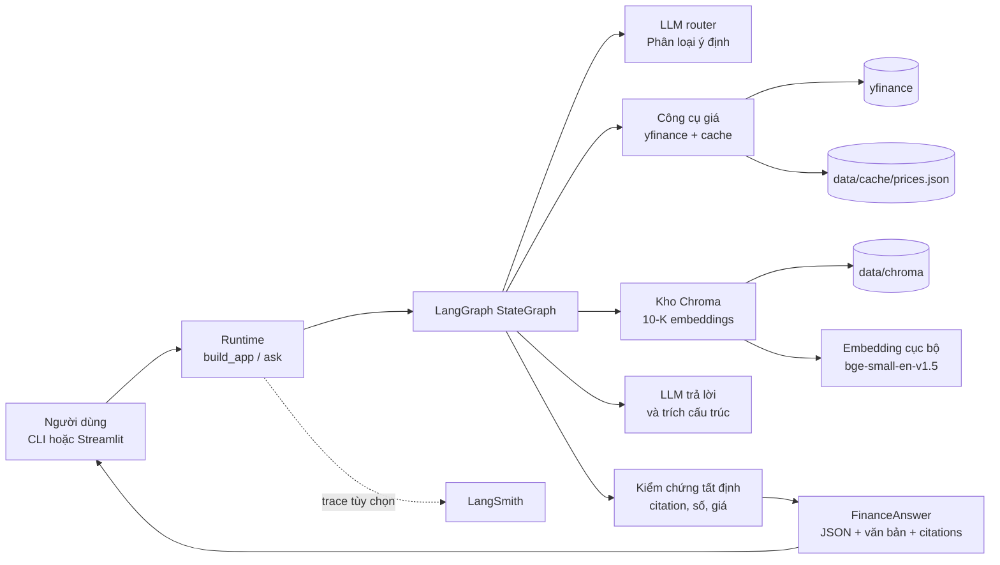
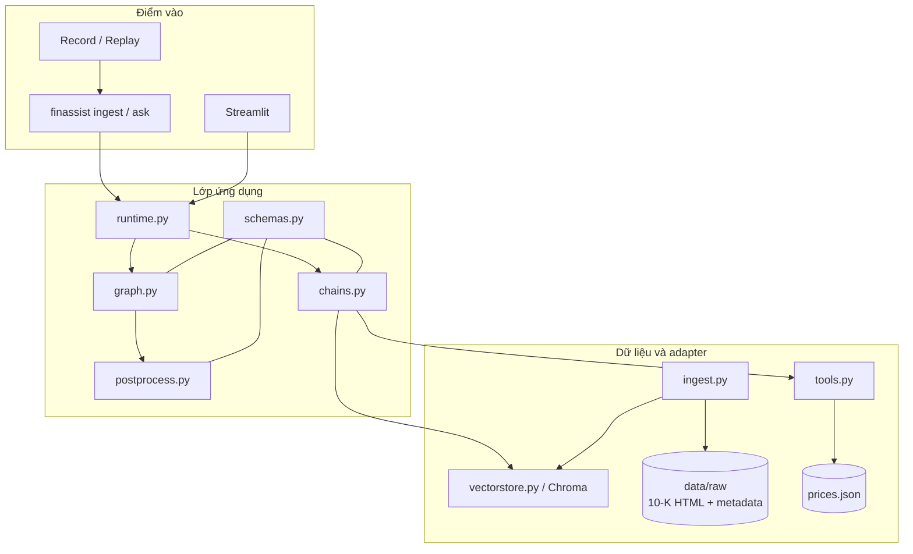
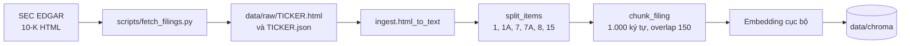
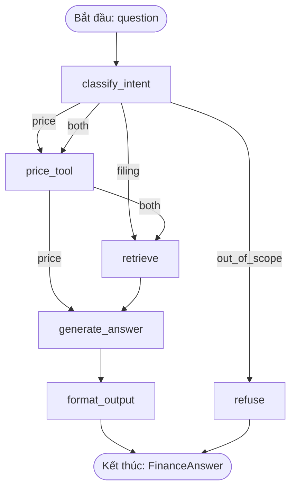
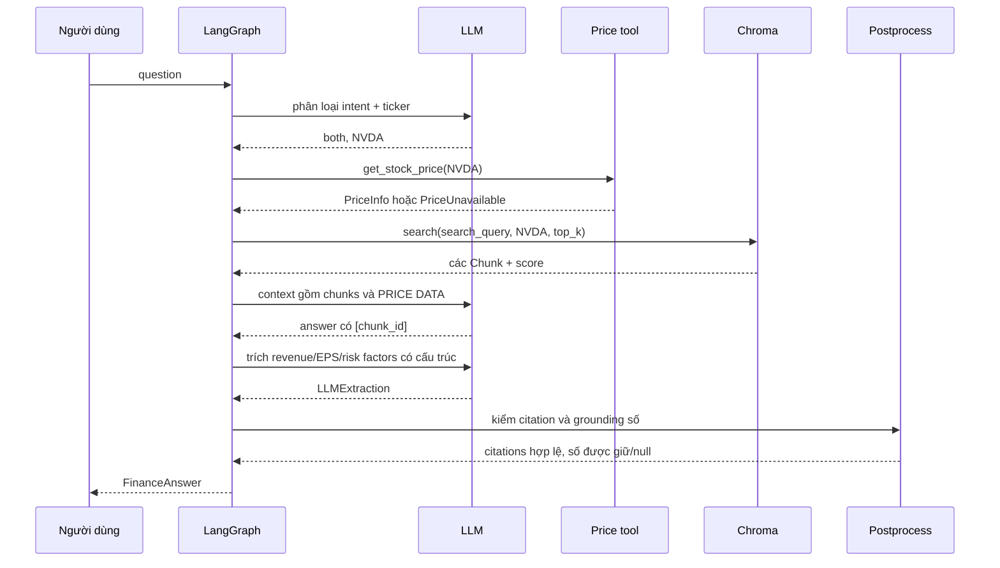
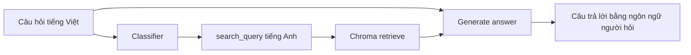
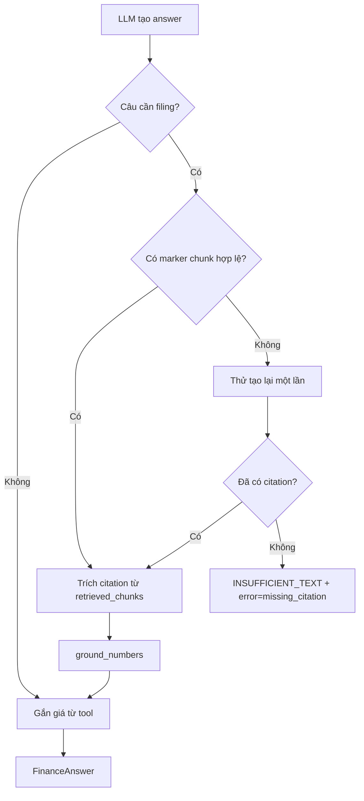

# Kiến trúc ứng dụng FinAssist

`finassist` là trợ lý AI tài chính chỉ phục vụ ba công ty: Apple (AAPL), Microsoft (MSFT) và NVIDIA (NVDA). Ứng dụng trả lời hai loại thông tin có bản chất khác nhau:

- Thông tin trong báo cáo 10-K: được tìm trong kho dữ liệu nội bộ bằng RAG và phải có trích dẫn.
- Giá, vốn hóa thị trường, P/E hiện tại: được lấy bằng công cụ tất định, không để LLM tự tạo.

Ứng dụng không tư vấn mua/bán, không dự đoán giá và từ chối các câu hỏi nằm ngoài phạm vi. Tài liệu này giải thích thành phần, đường đi của control flow và data flow, hàng rào an toàn, cũng như lý do của các quyết định chính. Tất cả mô tả dựa trên mã nguồn hiện tại trong `src/finassist/`.

## 1. Cách đọc nhanh

Người mới nên đọc theo thứ tự sau:

1. **Bức tranh tổng thể** để biết ứng dụng phụ thuộc vào những hệ thống nào.
2. **Control flow** để biết mỗi loại câu hỏi đi qua node nào.
3. **Data flow** để biết dữ liệu nào do LLM tạo, dữ liệu nào được mã nguồn xác nhận.
4. **Hàng rào an toàn** để hiểu tại sao kết quả có thể là `null` hoặc "không đủ thông tin".
5. **Quyết định và giới hạn** trước khi diễn giải chất lượng của hệ thống.

## 2. Bức tranh tổng thể



### Ranh giới trách nhiệm

| Thành phần | Trách nhiệm | Không chịu trách nhiệm cho |
|---|---|---|
| CLI / Streamlit | nhận câu hỏi, hiển thị hoặc phát lại kết quả đã ghi | suy luận tài chính, tìm kiếm, tạo citation |
| `runtime.py` | lắp LLM, embedding, Chroma và đồ thị; gọi đồ thị với metadata trace | quyết định node nào chạy |
| `graph.py` | điều phối control flow và áp các quy tắc an toàn không được giao cho LLM | gọi trực tiếp API nhà cung cấp |
| `chains.py` | prompt, gọi LLM và chuyển lời gọi bên ngoài thành `Deps` | tin tuyệt đối vào output của LLM |
| `vectorstore.py` | tìm các đoạn 10-K theo ticker | xác nhận một con số có đúng nghĩa hay không |
| `tools.py` | lấy giá, lưu cache an toàn, báo dữ liệu cũ/không có dữ liệu | giải thích rủi ro kinh doanh |
| `postprocess.py` | chỉ giữ citation hợp lệ và loại số không có trong context | tạo câu trả lời mới |

Tách biệt này quan trọng: LLM là thành phần tạo ngôn ngữ, nhưng đường đi, giá, citation và kiểm tra số liệu vẫn nằm trong mã tất định có thể unit test.

## 3. Thành phần và dữ liệu mà chúng quản lý



### 3.1 Nạp dữ liệu 10-K: luồng chạy trước khi hỏi

Đây là luồng **offline/chuẩn bị**, không chạy cho từng câu hỏi.



Mỗi đoạn có `chunk_id` ổn định, ví dụ `AAPL-2025-1A-012`, và metadata gồm ticker, năm tài chính, Item và URL nguồn. `FilingStore.upsert` dùng `chunk_id` làm ID Chroma, nên chạy ingest lại không tạo thêm bản sao.

Parser chỉ giữ Item 1, 1A, 7, 7A, 8 và 15. Item 15 cần thiết vì 10-K của NVIDIA để nhiều báo cáo tài chính ở đó. Parser cũng gộp running header lặp liên tiếp, tránh chia sai Item 8 của Microsoft thành nhiều phần.

### 3.2 Mô hình dữ liệu cốt lõi

| Kiểu | Ý nghĩa | Nguồn tạo ra |
|---|---|---|
| `Chunk` | một đoạn 10-K cùng metadata và khoảng cách truy hồi `score` | ingestion hoặc Chroma search |
| `PriceInfo` | giá, vốn hóa, P/E, thời điểm `as_of`, cờ `stale` | `get_stock_price` |
| `IntentResult` | intent, ticker, ngôn ngữ và `search_query` | LLM classifier, sau đó được graph lọc |
| `Citation` | nguồn, Item, `chunk_id`, 200 ký tự đầu của đoạn | `extract_citations`, không do LLM tạo |
| `FinanceAnswer` | output cuối: văn bản, JSON cấu trúc, giá và citations | graph kết hợp LLM với dữ liệu tất định |

`FinanceAnswer.revenue` dùng đơn vị **triệu USD**, đúng như số in trong filing. `stock_price` chỉ được đặt khi có đúng một ticker; `stock_prices` luôn có thể chứa danh sách giá cho câu hỏi nhiều công ty.

## 4. Control flow: đồ thị xử lý câu hỏi

`build_graph` trong `graph.py` tạo một `StateGraph` gồm sáu node. Hai cạnh điều kiện quyết định đường đi.



### 4.1 Ý nghĩa của từng nhánh

| Intent | Khi nào dùng | Node chạy | Điều không xảy ra |
|---|---|---|---|
| `price` | chỉ cần giá, vốn hóa hoặc P/E | `classify_intent → price_tool → generate_answer → format_output` | không truy hồi 10-K, không có citation filing |
| `filing` | chỉ cần thông tin trong 10-K | `classify_intent → retrieve → generate_answer → format_output` | không gọi nguồn giá |
| `both` | cần cả dữ liệu thị trường và filing | `classify_intent → price_tool → retrieve → generate_answer → format_output` | không bỏ qua một trong hai nguồn |
| `out_of_scope` | công ty khác, dự đoán giá, tư vấn mua/bán, nội dung không phải tài chính trong phạm vi | `classify_intent → refuse` | không gọi giá, Chroma hay LLM tạo câu trả lời |

Ví dụ, câu “Should I buy NVIDIA stock now?” dừng ở `refuse`. Điều này giới hạn chi phí, tránh đưa context không liên quan vào LLM và tránh biến câu trả lời thành lời khuyên đầu tư.

### 4.2 Nhiệm vụ của sáu node

| Node | Đọc từ state | Ghi vào state | Hành vi quan trọng |
|---|---|---|---|
| `classify_intent` | `question` | `intent`, `tickers`, `search_query`, các danh sách rỗng ban đầu | chuẩn hóa ticker, bỏ ticker ngoài AAPL/MSFT/NVDA; không có ticker hợp lệ thì chuyển thành `out_of_scope` |
| `price_tool` | `tickers` | `price_data`, có thể `error` | lấy lần lượt từng ticker; một ticker lỗi không làm hỏng toàn bộ câu hỏi |
| `retrieve` | `search_query`, `tickers` | `retrieved_chunks` | lấy top-k theo từng ticker, lọc ngay trong Chroma theo metadata ticker |
| `generate_answer` | câu hỏi gốc, chunks, giá, lỗi | `answer`, có thể `error`, `short_circuit` | LLM chỉ dùng context; câu filing phải có marker citation hợp lệ |
| `format_output` | toàn bộ output trung gian | `output: FinanceAnswer` | LLM trích field, sau đó graph ghi đè citation và giá bằng dữ liệu tất định |
| `refuse` | không cần dữ liệu khác | `answer`, `output` | trả mẫu từ chối cố định song ngữ |

## 5. Data flow của một câu hỏi `both`

Ví dụ: **“What is NVIDIA's current stock price and how do export controls threaten it?”**



Luồng thực tế trong trace LangSmith `01a18548-f611-70d1-ad75-5bb267a4a30e` đi theo đúng nhánh trên:

| Bước | Thành phần | Dữ liệu truyền đi | Ý nghĩa |
|---|---|---|---|
| 1 | `classify_intent` | câu hỏi → `intent=both`, `tickers=[NVDA]` | chọn cả nguồn giá và 10-K |
| 2 | `price_tool` | `NVDA` → `PriceInfo` | tạo dữ liệu giá có thời điểm và cờ `stale` |
| 3 | `retrieve` | `search_query`, `NVDA` → 5 chunk | trace có các chunk Item 1A và Item 15, gồm `NVDA-2026-1A-126` |
| 4 | `generate_answer` | câu hỏi gốc + chunk + khối PRICE DATA → văn bản | claim về filing phải kết thúc bằng ID chunk; giá không dùng citation filing |
| 5 | `format_output` | văn bản + context → extraction, sau đó postprocess | giao diện nhận một `FinanceAnswer` nhất quán |

Trace dạng văn bản và URL LangSmith nằm trong [`docs/evidence/trace_tree.md`](evidence/trace_tree.md) và [`docs/evidence/links.md`](evidence/links.md). Giá trong trace là snapshot lịch sử; khi trình bày kết quả live luôn dùng `as_of` của lần gọi hiện tại.

## 6. Câu hỏi tiếng Việt: tách ngôn ngữ hiển thị và ngôn ngữ truy hồi

10-K và embedding `BAAI/bge-small-en-v1.5` chủ yếu là tiếng Anh, trong khi người dùng có thể hỏi tiếng Việt. Nếu tìm bằng nguyên văn câu tiếng Việt, các đoạn rủi ro tiếng Anh có thể không xuất hiện trong top-k.

Vì vậy, classifier luôn trả thêm:

- `language`: `en` hoặc `other`;
- `search_query`: bản viết lại tiếng Anh của câu hỏi khi ngôn ngữ là `other`.



`retrieve` dùng `search_query`, nhưng `generate_answer` vẫn nhận `question` gốc và prompt yêu cầu trả lời theo ngôn ngữ của người hỏi. Với câu tiếng Anh, graph bỏ `search_query` do LLM trả và tìm bằng câu gốc để không thay đổi hành vi hiện có. Nếu bản viết lại trống, graph cũng quay về dùng câu gốc.

## 7. Hàng rào chống câu trả lời sai hoặc không kiểm chứng được



### 7.1 Citation

`extract_citations` chỉ chấp nhận marker đúng định dạng, ví dụ `[AAPL-2025-1A-012]`, **và** ID đó phải có trong `retrieved_chunks` của chính run hiện tại. Marker không có trong context bị bỏ qua; marker lặp chỉ xuất hiện một lần trong output. Vì vậy, LLM không thể thêm một ID trông có vẻ hợp lệ nhưng không được retrieve.

### 7.2 Số liệu tài chính

LLM chỉ hỗ trợ trích `revenue`, `eps` và `risk_factors` thành dữ liệu có cấu trúc. Sau đó `ground_numbers` kiểm tra chuỗi số đã in có xuất hiện như một số độc lập trong các chunk retrieved hay không. Nếu không, `revenue` hoặc `eps` bị đặt `null`.

Đây là kiểm chứng về **sự xuất hiện trong context**, không phải kiểm chứng ngữ nghĩa của một bảng. Ví dụ một số có thể thuộc một cột hoặc phân khúc khác nhưng vẫn xuất hiện trong chunk. Do đó, `null` an toàn hơn là bịa, nhưng giá trị không phải `null` vẫn cần đọc cùng citation.

### 7.3 Dữ liệu giá và lỗi từng phần

`get_stock_price` gọi `yfinance` trước. Nếu thành công, dữ liệu mới (`stale=false`) được ghi atomically vào `data/cache/prices.json`. Nếu gọi live thất bại hoặc `FINASSIST_PRICE_OFFLINE=1`, tool trả cache với `stale=true`. Nếu không có cache hợp lệ, tool ném `PriceUnavailable`.

Graph thu thập lỗi theo từng ticker thay vì làm hỏng run:

- Câu `price` không lấy được bất kỳ giá nào trả `PRICE_UNAVAILABLE_TEXT`.
- Câu `both` vẫn có thể trả lời phần filing, đồng thời thêm ghi chú ticker nào thiếu giá.
- Với nhiều ticker, `stock_prices` giữ những giá lấy được; `stock_price` để `null` vì không thể đại diện cho một công ty duy nhất.

### 7.4 Chặn câu ngoài phạm vi

Việc từ chối hiện dựa vào classifier, không có keyword rule thứ hai. Đây là một lựa chọn có chủ ý để hiểu ngữ cảnh câu hỏi tự nhiên, nhưng cũng là rủi ro: nếu classifier gán nhầm câu tư vấn đầu tư thành `price`, các node sau không có lớp chặn chuyên biệt. Các biến thể câu hỏi này cần được mở rộng trong integration test.

## 8. Output contract: `FinanceAnswer`

| Trường | Ý nghĩa và nguồn tin cậy |
|---|---|
| `intent` | classifier đã được graph lọc theo phạm vi |
| `answer` | LLM hoặc mẫu từ chối/không đủ thông tin |
| `ticker`, `fiscal_year` | `structure()` điền tất định từ chunk: chỉ khi tập chunk thuộc một ticker thì đặt `ticker` và `fiscal_year` (năm lớn nhất); nhiều ticker thì `fiscal_year` để null; graph bổ sung `ticker` khi câu chỉ có một công ty |
| `revenue`, `eps`, `risk_factors` | LLM extraction; `revenue`/`eps` còn phải qua `ground_numbers` |
| `citations` | chỉ từ `extract_citations`, không tin vào object do LLM trả |
| `stock_price`, `stock_prices` | chỉ từ công cụ giá, graph ghi đè mọi giá trị từ LLM |

Contract này giúp CLI, Streamlit, record/replay và evaluator dùng cùng một hình dạng dữ liệu. `to_record` lưu cả `FinanceAnswer`, lỗi và nội dung chunk đã retrieve để một run có thể được tái hiện offline.

## 9. Quan sát và vận hành

`runtime.ask` gọi `app.invoke` với `run_name=finassist`, tag mặc định `demo` và metadata `app_version`. Khi biến `LANGSMITH_*` được cấu hình, LangChain ghi lại chuỗi node, lời gọi LLM, tool input/output và context retrieve lên LangSmith.

Các cách chạy chính:

```bash
# Nạp 10-K vào Chroma
uv run finassist ingest

# Chạy live, có thể lưu một bản record
uv run finassist ask "What is NVIDIA's current stock price and how do export controls threaten it?" --record runs/demo.json

# Phát lại offline: câu hỏi truyền vào không được thực thi
uv run finassist ask x --replay runs/demo.json

# Mở giao diện; checkbox Replay dùng runs/demo.json
uv run streamlit run app/streamlit_app.py
```

Để lấy URL trace mới nhất: `uv run python scripts/trace_link.py`.

## 10. Quyết định kiến trúc và đánh đổi

| Quyết định | Phương án chọn | Lý do và đánh đổi |
|---|---|---|
| Điều phối | LangGraph với cạnh điều kiện | đường đi theo intent nhìn thấy và test được; ReAct tự do khó dự đoán, pipeline tuyến tính không biểu đạt nhánh. |
| Dependency injection | `Deps` truyền vào graph | unit test dùng fake được, nhưng cần `chains.py` làm lớp ghép các dependency thật. |
| Kho vector | Chroma với filter ticker trong truy vấn | tránh lẫn tài liệu giữa công ty; Chroma lưu cục bộ. |
| Embedding | `bge-small-en-v1.5` cục bộ | không cần khóa bổ sung và không gửi filing đi nơi khác; điểm yếu là hỗ trợ đa ngôn ngữ không phải mục tiêu chính. |
| Truy hồi | top-k cho từng ticker | câu so sánh có cơ hội lấy context của từng công ty; đổi lại số chunk/prompt dài hơn và vẫn có thể bỏ lỡ đoạn bảng đúng. |
| Trích dẫn | marker trong answer, postprocess tạo citation | chống bịa ID tốt hơn để LLM trả object citation; phụ thuộc LLM tuân thủ format marker. |
| Giá thị trường | tool + cache, graph ghi đè LLM | giá có nguồn và cờ dữ liệu cũ; phụ thuộc yfinance/cache. |
| Số liệu | `ground_numbers` | tránh số hoàn toàn không có trong context; chưa hiểu được ngữ nghĩa cột của bảng. |
| Từ chối | classifier `out_of_scope` | linh hoạt với ngôn ngữ tự nhiên; cần thêm test để giảm false negative. |
| Model đánh giá | cùng model router cho baseline | cấu hình đơn giản; self-grading có thể làm faithfulness cao hơn thực tế. |

## 11. Giới hạn đã biết và bước tiếp theo

1. **Retrieval bảng số liệu:** top-k theo vector thường bỏ lỡ chunk chứa bảng. Trong baseline, năm case tệ nhất đều không retrieve được golden chunk.
2. **Ngữ nghĩa bảng:** một con số có trong context vẫn có thể thuộc cột hoặc phân khúc không đúng. Grounding hiện chưa giải được vấn đề này.
3. **Ngôn ngữ:** bản viết lại tiếng Anh giúp câu tiếng Việt truy hồi tốt hơn, nhưng chất lượng vẫn phụ thuộc classifier và embedding tiếng Anh.
4. **Từ chối tư vấn:** không có lớp kiểm tra thứ hai sau classifier.
5. **Đánh giá:** judge trùng model ứng dụng nên không phải kiểm chứng độc lập.

Ưu tiên tiếp theo là hybrid retrieval (BM25 + vector) có reranker, đồng thời bảo toàn tiêu đề cột và nhãn dòng khi chia bảng. Mục tiêu đo lường và baseline được nêu trong [`docs/NEXT_STEP.md`](NEXT_STEP.md).

## 12. Bằng chứng và tài liệu liên quan

- [`docs/evidence/trace_tree.md`](evidence/trace_tree.md): bản text của hai trace thật.
- [`docs/evidence/links.md`](evidence/links.md): URL LangSmith và cách tạo lại bằng chứng.
- [`reports/ragas_baseline.md`](../reports/ragas_baseline.md): quality baseline và caveat.
- [`docs/KNOWLEDGE_CHECK.md`](KNOWLEDGE_CHECK.md): câu trả lời mẫu để giải thích, dự đoán, gỡ lỗi và bảo vệ lựa chọn.
- [`docs/NEXT_STEP.md`](NEXT_STEP.md): kế hoạch cải thiện retrieval.
