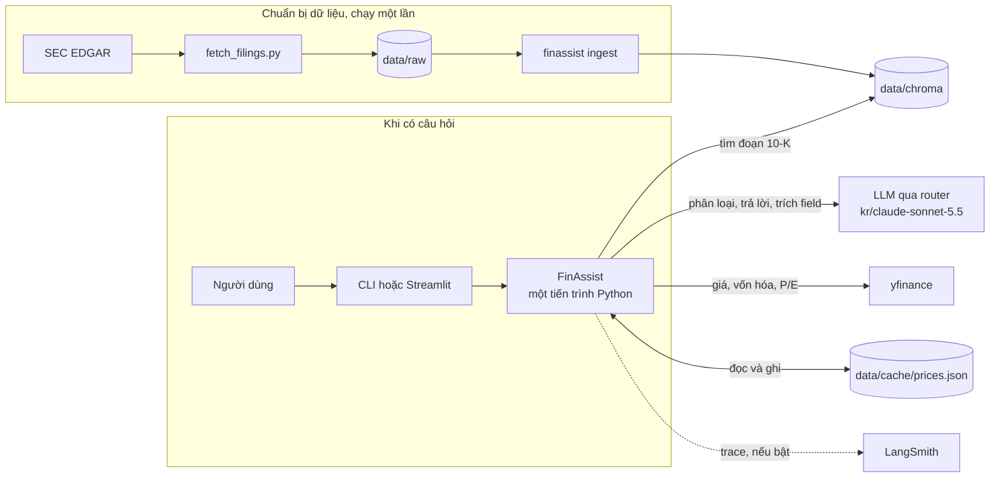
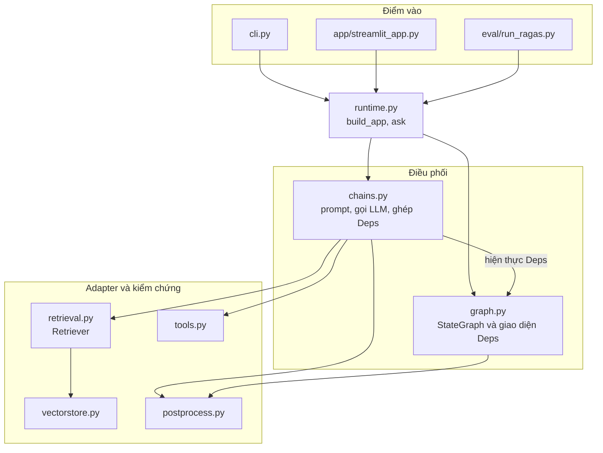
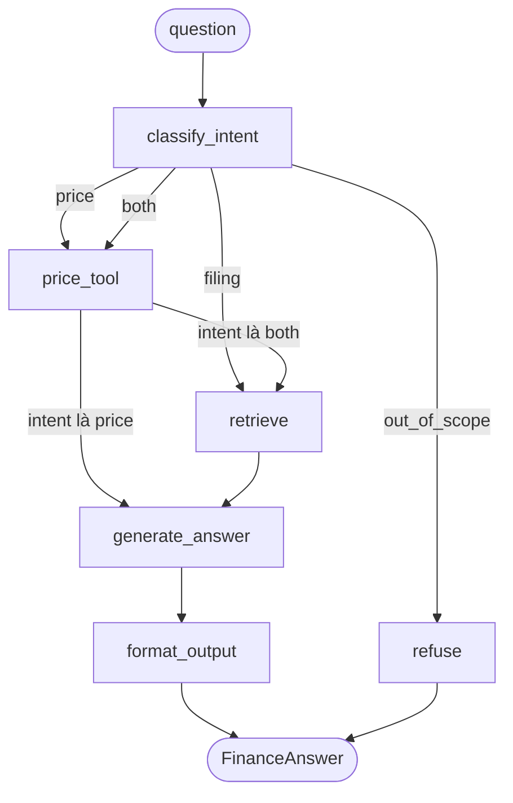
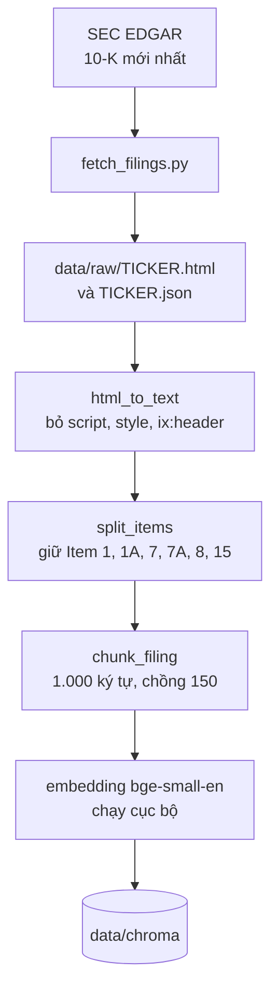
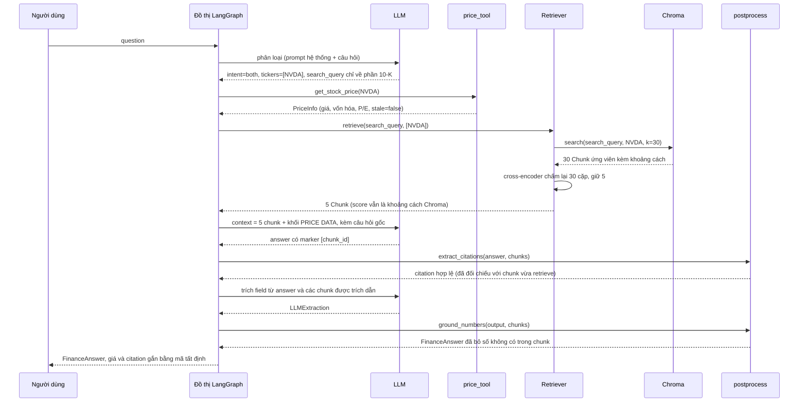
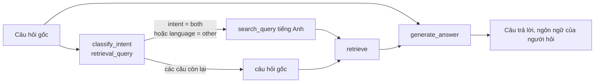
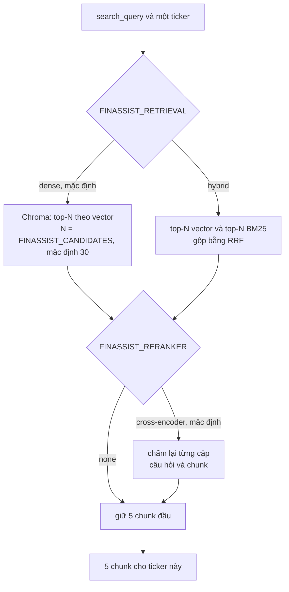
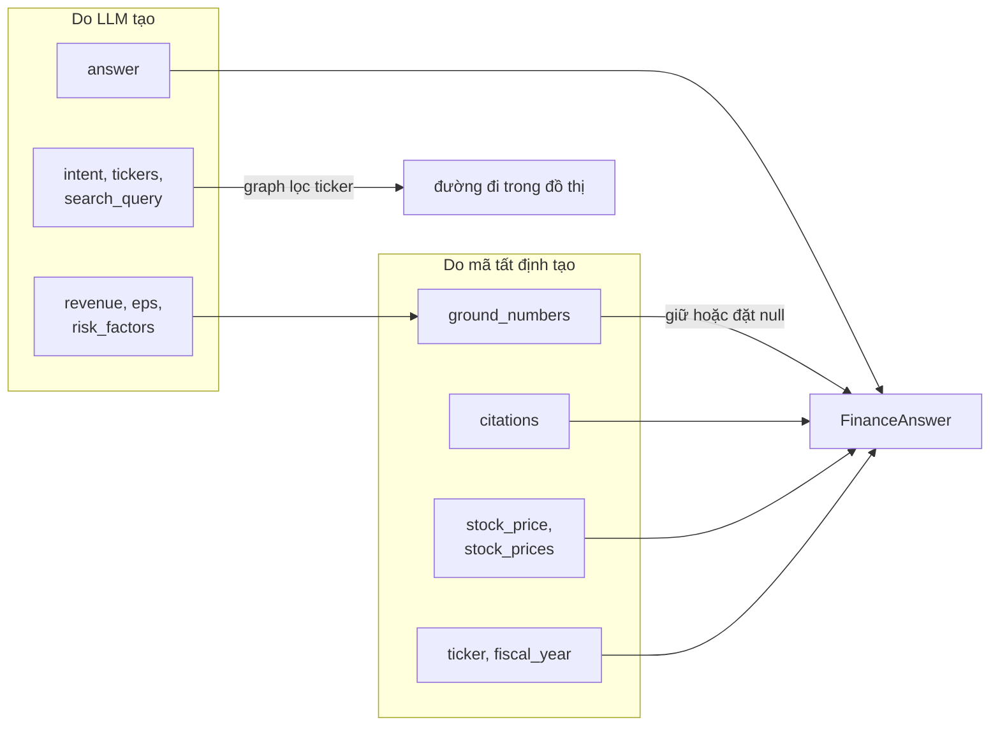
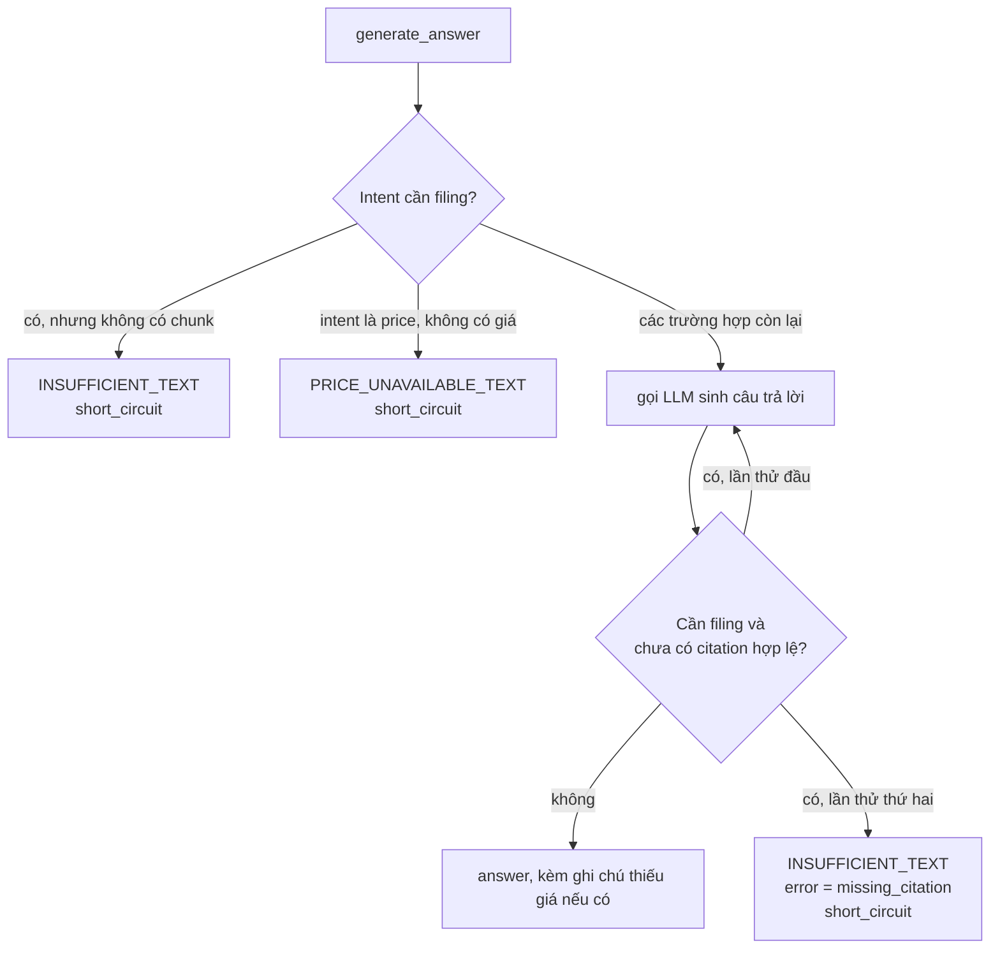

# Kiến trúc ứng dụng FinAssist

FinAssist là trợ lý tài chính cho ba công ty: Apple (AAPL), Microsoft (MSFT) và NVIDIA (NVDA). Ứng dụng nhận hai loại câu hỏi và xử lý chúng bằng hai cơ chế khác nhau.

- Câu hỏi về nội dung báo cáo 10-K (doanh thu, EPS, rủi ro, MD&A) được trả lời bằng RAG trên một kho Chroma chạy cục bộ, kèm trích dẫn đến từng đoạn nguồn.
- Câu hỏi về giá, vốn hóa và P/E được trả lời bằng một công cụ gọi yfinance. Những con số này đổi theo từng phút nên LLM không được tự đưa ra.

Câu hỏi nằm ngoài hai loại trên bị từ chối, gồm tư vấn mua bán, dự đoán giá và các công ty khác.

Tài liệu mô tả ứng dụng đúng như mã trong `src/finassist/`. Các mục đi theo thứ tự một người mới thường hỏi: hệ thống có những phần nào (mục 1 và 2), một câu hỏi đi qua đâu (mục 3), dữ liệu đến từ đâu và ai tạo ra nó (mục 4 và 5), khi có sự cố thì chuyện gì xảy ra (mục 6), vì sao thiết kế như vậy (mục 7) và những gì còn chưa tốt (mục 8).

## 1. Hệ thống nhìn từ bên ngoài

Toàn bộ ứng dụng chạy trong một tiến trình Python. Embedding và mô hình reranker cũng chạy ngay trong tiến trình đó, nên chỉ có ba dịch vụ bên ngoài: router LLM, yfinance và SEC EDGAR. Hai mô hình cục bộ được tải từ Hugging Face ở lần chạy đầu tiên rồi nằm trong cache của máy. SEC EDGAR chỉ được gọi lúc chuẩn bị dữ liệu, còn LangSmith chỉ nhận trace khi được bật.



Hai nhóm ở trên chạy ở hai thời điểm khác nhau. Nhóm chuẩn bị chạy một lần trước khi dùng và để lại kho Chroma. Nhóm thứ hai chạy mỗi khi có câu hỏi và đọc kho đó.

## 2. Các thành phần

### 2.1 Ai gọi ai



`schemas.py` (các kiểu dữ liệu) và `config.py` (cấu hình) được hầu hết các module dùng nên không vẽ vào sơ đồ. `retrieval.py` đứng giữa `chains.py` và `vectorstore.py`: `chains.py` hỏi `Retriever`, còn `Retriever` mới hỏi kho Chroma.

Điểm đáng nhìn kỹ là mũi tên giữa `chains.py` và `graph.py`. `graph.py` không biết gì về LLM, Chroma hay yfinance. Nó chỉ biết một dataclass `Deps` gồm năm hàm: `classify`, `retrieve`, `price`, `generate`, `structure`. `chains.py` hiện thực năm hàm đó bằng các dịch vụ thật, còn test thay chúng bằng hàm giả. Nhờ vậy toàn bộ logic điều hướng và kiểm chứng chạy được trong unit test mà không cần mạng.

### 2.2 Từng module làm gì

| Module | Nhận vào | Trả ra | Gọi dịch vụ ngoài |
|---|---|---|---|
| `cli.py` | dòng lệnh `ingest` hoặc `ask` | văn bản và JSON in ra terminal, file record | không (qua `runtime`) |
| `app/streamlit_app.py` | câu hỏi trong ô nhập | trang web: câu trả lời, citation, chunk, JSON | không (qua `runtime`) |
| `runtime.py` | cấu hình | `build_app()` dựng đồ thị hoàn chỉnh, `ask()` chạy một câu hỏi kèm tag và metadata trace | không |
| `graph.py` | `Deps` | đồ thị LangGraph biên dịch sẵn | không |
| `chains.py` | `Settings`, kho Chroma, client LLM | một `Deps` thật (hàm `retrieve` đi qua `Retriever`); chứa ba prompt (phân loại, trả lời, trích field) | router LLM |
| `retrieval.py` | câu truy vấn, danh sách ticker, `Settings` | `Retriever.retrieve` trả `Chunk` (5 chunk mỗi ticker): vector top-30 rồi cross-encoder chấm lại; có tùy chọn BM25 và RRF | mô hình reranker cục bộ |
| `vectorstore.py` | danh sách `Chunk`, câu truy vấn | `search(query, ticker, k)` trả `Chunk` kèm khoảng cách; `chunks_for(ticker)`; `reset()` | Chroma, mô hình embedding cục bộ |
| `tools.py` | mã ticker | `PriceInfo` (giá, vốn hóa, P/E, `as_of`, `stale`) hoặc lỗi `PriceUnavailable` | yfinance, file cache |
| `postprocess.py` | câu trả lời, các chunk đã retrieve | danh sách `Citation` hợp lệ; `FinanceAnswer` đã bỏ số không có trong chunk | không |
| `ingest.py` | HTML của 10-K | các `Chunk` có metadata; tùy chọn đổi mỗi hàng bảng thành một dòng văn bản | không |
| `schemas.py` | không | các kiểu Pydantic dùng chung | không |
| `config.py` | file `.env` và biến môi trường | `Settings` | không |

### 2.3 Các kiểu dữ liệu chính

| Kiểu | Chứa gì | Ai tạo |
|---|---|---|
| `Chunk` | một đoạn 10-K: `chunk_id`, text, ticker, năm tài chính, Item, `score` (khoảng cách Chroma, càng thấp càng gần; chunk chỉ do BM25 tìm thấy thì là `None`) | `ingest.py`, rồi `vectorstore.search` |
| `PriceInfo` | giá, vốn hóa, P/E, thời điểm `as_of`, cờ `stale` | `tools.get_stock_price` |
| `IntentResult` | intent, danh sách ticker, `language`, `search_query` | LLM phân loại |
| `LLMExtraction` | `ticker`, `fiscal_year`, `revenue`, `eps`, `risk_factors` | LLM trích field |
| `Citation` | nguồn, Item, `chunk_id`, 200 ký tự đầu của chunk | `postprocess.extract_citations` |
| `FinanceAnswer` | kết quả cuối cùng của một câu hỏi | `graph.py`, ghép từ LLM và dữ liệu tất định |

`revenue` luôn tính bằng triệu USD, đúng như số in trong 10-K.

## 3. Control flow: một câu hỏi đi qua những node nào

Đồ thị có sáu node và hai điểm rẽ nhánh. Điểm rẽ đầu tiên đọc `intent` do `classify_intent` ghi ra. Điểm rẽ thứ hai nằm sau `price_tool` và quyết định có cần tra thêm 10-K hay không.



### 3.1 Bốn đường đi

| Intent | Khi nào | Đường đi | Số lần gọi LLM |
|---|---|---|---|
| `price` | chỉ cần giá, vốn hóa hoặc P/E | classify → price_tool → generate → format | 2 |
| `filing` | chỉ cần thông tin trong 10-K | classify → retrieve → generate → format | 3 |
| `both` | cần cả giá và 10-K | classify → price_tool → retrieve → generate → format | 3 |
| `out_of_scope` | công ty khác, tư vấn đầu tư, dự đoán giá, chủ đề không liên quan | classify → refuse | 1 |

Số lần gọi LLM là số lần tối thiểu. `generate_answer` có thể gọi thêm một lần khi câu trả lời về filing chưa có citation hợp lệ. Câu `price` chỉ gọi LLM hai lần vì không có chunk nào để trích field, nên `structure` bỏ qua bước gọi LLM.

Câu "Should I buy NVIDIA stock now?" dừng ở `refuse`. Trace thật của câu này chỉ có `classify_intent` và `refuse`, mất khoảng 0,25 giây, không đụng tới giá, Chroma hay bước sinh câu trả lời.

### 3.2 Mỗi node làm gì

State của đồ thị là một `TypedDict` tên `GraphState`. Mỗi node đọc một vài khóa và ghi lại một vài khóa.

| Node | Đọc | Ghi | Hành vi |
|---|---|---|---|
| `classify_intent` | `question` | `intent`, `tickers`, `search_query`, và khởi tạo `retrieved_chunks=[]`, `price_data=[]`, `error=None`, `short_circuit=False` | Chuẩn hóa ticker (cắt khoảng trắng, viết hoa), bỏ ticker ngoài AAPL/MSFT/NVDA. Nếu intent cần dữ liệu mà không còn ticker hợp lệ thì đổi thành `out_of_scope`. Sau đó `retrieval_query` chọn truy vấn cho `retrieve`: `search_query` tiếng Anh của bộ phân loại khi intent đã lọc là `both` hoặc ngôn ngữ là `other`, còn lại là câu hỏi gốc (mục 4.4). |
| `price_tool` | `tickers` | `price_data`, `error` | Lấy giá từng ticker. Ticker nào lỗi thì ghi lý do vào `error`, các ticker còn lại vẫn chạy bình thường. |
| `retrieve` | `search_query`, `tickers` | `retrieved_chunks` | Truy vấn là `search_query`, tức bản viết lại tiếng Anh với câu `both` và câu không phải tiếng Anh, còn câu khác là câu hỏi gốc. Với mỗi ticker, `Retriever` lấy 30 chunk ứng viên từ Chroma (lọc theo ticker ngay trong truy vấn), cross-encoder `ms-marco-MiniLM-L-6-v2` chấm lại từng cặp câu hỏi và chunk, rồi giữ 5 chunk điểm cao nhất (k = 5 vẫn là số chunk gửi cho LLM). Đặt `FINASSIST_RERANKER=none` thì bỏ bước chấm lại và trả top-5 của vector, đúng như trước đây. Chi tiết ở mục 4.5. |
| `generate_answer` | câu hỏi gốc, chunk, giá | `answer`, và có thể `error`, `short_circuit` | Gọi LLM với context gồm chunk và khối `PRICE DATA`. Với câu cần filing, kiểm tra citation và thử lại nếu thiếu (xem mục 5.2). |
| `format_output` | toàn bộ state | `output` (`FinanceAnswer`) | Gọi LLM trích field, rồi ghi đè citation và giá bằng dữ liệu tất định. |
| `refuse` | không đọc gì | `answer`, `output` | Trả mẫu từ chối song ngữ cố định. |

`search_query` luôn có giá trị sau `classify_intent`. Nó là câu hỏi gốc, trừ khi intent là `both` hoặc người dùng hỏi bằng ngôn ngữ khác tiếng Anh (xem mục 4.4). `generate_answer` luôn nhận câu hỏi gốc.

## 4. Data flow: dữ liệu đến từ đâu và đi đâu

### 4.1 Nạp 10-K, chạy trước khi hỏi



Mỗi chunk có `chunk_id` ổn định, ví dụ `AAPL-2025-1A-012` (ticker, năm tài chính, Item, số thứ tự trong Item). Chroma dùng chính `chunk_id` làm khóa nên chạy `finassist ingest` lần hai không tạo thêm bản sao: kho có 1.162 chunk (AAPL 256, MSFT 451, NVDA 455) và con số này không đổi sau mỗi lần nạp.

Hai bước của ingestion có công tắc riêng, cả hai tắt mặc định vì phép đo không ủng hộ chúng (mục 7.6).

- `FINASSIST_TABLE_ROWS=1` làm `html_to_text` đổi mỗi hàng `<tr>` thành một dòng, các ô nối bằng ` | `, ví dụ `Data Center | 193,737 | 115,186 | 47,525`. Ở dạng mặc định mỗi ô là một dòng riêng và nhãn hàng tách khỏi con số.
- `FINASSIST_EMBED_PREFIX=1` embed thêm tiền tố kiểu `AAPL FY2025 Item 8` trước nội dung chunk. Chroma vẫn chỉ lưu nội dung gốc, nên LLM không thấy tiền tố.

Đổi chunking làm `chunk_id` đổi theo, nên sau khi bật một trong hai biến phải chạy `uv run finassist ingest --rebuild`. Lệnh này xóa collection rồi nạp lại. Chạy `ingest` thường sau khi đổi sẽ để lại chunk cũ trong kho. Khi thử nghiệm, kho khác được chọn bằng `FINASSIST_CHROMA_DIR`, vì vậy `data/chroma` không bị đụng tới. Kho theo hàng bảng có 1.168 chunk (AAPL 261, MSFT 452, NVDA 455), nhiều hơn kho chuẩn 6 chunk.

Ba chi tiết của 10-K thật đã ảnh hưởng tới parser:

- 10-K liệt kê mỗi Item hai lần, một lần trong mục lục và một lần ở phần thân. `split_items` giữ đoạn dài nhất của mỗi Item, tức là phần thân. Dòng bắt đầu bằng "Item 1A" nhưng nằm giữa một câu tham chiếu (ví dụ "see Item 1A of this Form") bị loại bằng `_is_heading`.
- Microsoft in lại tiêu đề "PART II / Item N" ở đầu mỗi trang, làm một Item bị cắt thành nhiều phần. Parser gộp các tiêu đề lặp liên tiếp của cùng một Item.
- NVIDIA để phần lớn báo cáo tài chính ở Item 15, còn Item 8 chỉ có một đoạn ngắn. Vì vậy Item 15 nằm trong danh sách giữ lại.

### 4.2 Trả lời một câu hỏi `both`

Ví dụ lấy từ một trace LangSmith thật: "What is NVIDIA's current stock price and how do export controls threaten it?"



Thời gian từng bước trong trace đó:

| Bước | Thời gian | Dữ liệu ra |
|---|---|---|
| `classify_intent` | 0,30 giây | `intent=both` |
| `price_tool` | 1,67 giây | giá NVDA 215,38 USD, vốn hóa khoảng 5,2 nghìn tỷ USD, P/E 27,54 |
| `retrieve` | 0,74 giây | 5 chunk: `NVDA-2026-1A-126`, `1A-106`, `15-085`, `15-025`, `15-020` |
| `generate_answer` | 5,50 giây | câu trả lời có marker citation |
| `format_output` | 5,27 giây | `FinanceAnswer` hoàn chỉnh |
| Tổng | 13,65 giây | |

Trace này được ghi trước khi thêm reranker và trước khi có bản viết lại truy vấn, nên bước `retrieve` 0,74 giây là top-5 của vector với câu hỏi gốc. Với mã hiện tại, `retrieve` nhận bản viết lại "How do export controls threaten NVIDIA's business according to its 10-K?" (bản lưu cho q25 trong `reports/query_rewrites.json`), và ở hai lần chạy RAGAS `both_rewrite` top-5 là `1A-126`, `1A-106`, `1A-127`, `1A-107`, `1A-125`. Trong bộ đo truy hồi, reranker thêm khoảng 120 đến 140 ms mỗi lần truy hồi (p50 từ 12 ms lên 134 đến 149 ms), nhỏ so với hai bước còn lại. Hai bước chiếm gần hết thời gian đều là lời gọi LLM. URL trace và bản text của cây trace nằm ở [`evidence/links.md`](evidence/links.md) và [`evidence/trace_tree.md`](evidence/trace_tree.md). Giá trong trace là ảnh chụp tại thời điểm đó, vì vậy khi demo hãy đọc `as_of` của lần chạy hiện tại.

### 4.3 LLM nhìn thấy gì

Ba lời gọi LLM nhận ba loại đầu vào khác nhau.

- Phân loại: prompt hệ thống mô tả bốn intent và danh sách ba ticker, cùng một tin nhắn dạng `QUESTION (v2)` rồi đến câu hỏi. Kết quả trả về theo schema `IntentResult`. Prompt còn yêu cầu hai trường `language` và `search_query`. Với intent `both`, `search_query` luôn là một câu hỏi tiếng Anh tự đủ nghĩa chỉ về phần 10-K: bỏ mọi từ về giá, vốn hóa, P/E, cổ phiếu và thị trường, giữ tên của mọi công ty được hỏi (prompt có hai ví dụ, một tiếng Anh và một tiếng Việt). Với câu không phải tiếng Anh và intent khác `both`, `search_query` là bản dịch tiếng Anh giữ tên công ty và thuật ngữ tài chính. Với câu tiếng Anh còn lại, nó là null.
- Router lưu cache phản hồi theo các tin nhắn hội thoại và schema công cụ. Khóa cache không gồm prompt hệ thống và không gồm temperature (thí nghiệm trực tiếp ngày 2026-10-29: cùng tin nhắn người dùng với hai prompt hệ thống khác nhau trả về câu trả lời đầu tiên trong 0,02 giây; tin nhắn người dùng mới thì prompt mới có hiệu lực; lời gọi không có tin nhắn hệ thống hoặc với temperature 0,9 vẫn trúng cache; lời gọi thường không có schema thì không). Khi thêm các luật trên vào `CLASSIFY_SYSTEM`, phản hồi cũ vẫn được trả và thay đổi bị bỏ qua mà không có cảnh báo, cho đến khi tin nhắn người dùng đổi từ `QUESTION` thành `QUESTION (v2)`. Sửa `CLASSIFY_SYSTEM` không có tác dụng với các câu đã hỏi cho đến khi hậu tố này đổi, nên mỗi lần sửa phải đổi nó (v3, v4, ...), xem mục 8.
- Trả lời: prompt hệ thống ra luật (chỉ dùng context, mỗi khẳng định về filing phải kết thúc bằng `[chunk_id]`, không tư vấn đầu tư, trả lời bằng ngôn ngữ của người hỏi), tiếp theo là context và câu hỏi gốc. Context gồm từng chunk có tiêu đề `[chunk_id] (ticker năm Item)` và, nếu có, một khối `PRICE DATA` ghi rõ `stale`.
- Trích field: câu hỏi, câu trả lời và các chunk mà câu trả lời đã trích dẫn. Nếu câu trả lời không trích chunk nào thì dùng toàn bộ chunk. Kết quả theo schema `LLMExtraction`.

### 4.4 Truy vấn gửi cho retrieve

Câu hỏi gốc không phải lúc nào cũng là truy vấn tốt nhất. Embedding `bge-small-en-v1.5` và 10-K đều là tiếng Anh, và một câu hỏi `both` chứa cả phần giá lẫn phần báo cáo. Hai trường hợp này có phép đo.

- Câu tiếng Việt. Khi tìm bằng nguyên văn, khoảng cách tới các đoạn đúng lớn tới mức chúng không lọt vào top-k. Với câu rủi ro kiểm soát xuất khẩu của NVIDIA, top-5 không có chunk Item 1A nào (khoảng cách 0,71 đến 0,74), trong khi câu tiếng Anh tương đương cho khoảng cách 0,26.
- Câu `both`. Nhóm 5 câu `both` của bộ đo có any@5 40% khi tìm bằng câu gốc (0% ở vector thuần). Phần nói về giá có khả năng kéo truy vấn về các chunk khác với chunk bằng chứng, nhưng chưa có phép đo riêng cho giả thuyết đó; số đo chỉ cho thấy bản viết lại chỉ còn phần 10-K cải thiện kết quả (mục 7.6).

Bộ phân loại vì vậy trả thêm hai trường:

- `language`: `en` hoặc `other`.
- `search_query`: bản viết lại tiếng Anh. Với `both` nó luôn có và chỉ chứa phần 10-K; với câu không phải tiếng Anh nó là bản dịch; với câu tiếng Anh khác thì null.

Hàm `retrieval_query` trong `graph.py` chọn truy vấn theo bảng sau. Nó nhận intent đã qua bước lọc ticker, nên một câu `both` mà không còn ticker hợp lệ trở thành `out_of_scope` và không đi tới retrieve.

| Câu hỏi | Truy vấn gửi cho `retrieve` |
|---|---|
| intent là `both` (sau khi lọc ticker) | `search_query` tiếng Anh, chỉ phần 10-K |
| `language` là `other` | `search_query` tiếng Anh |
| mọi câu còn lại, kể cả câu `filing` tiếng Anh | câu hỏi gốc |

Nếu `search_query` rỗng thì dùng câu hỏi gốc.



`generate_answer` luôn nhận câu hỏi gốc, nên câu trả lời giữ ngôn ngữ của người hỏi và vẫn nhắc tới phần giá mà người dùng hỏi. Câu `filing` tiếng Anh vẫn tìm bằng câu gốc, nhờ vậy 20 câu không phải `both` của bộ đo không đổi: hạng của từng câu trùng khít với control, và danh sách chunk truy hồi của q01 đến q20 trùng khít ở cả bốn lần chạy RAGAS. Ví dụ cho `both`: câu q24 "Compare Apple's and Microsoft's latest annual revenue and tell me both current stock prices." được viết lại thành "Compare Apple's and Microsoft's total revenue in their most recent fiscal year.", và hạng của hai nhóm bằng chứng đổi từ [10, 12] thành [4, 4]. Ví dụ cho tiếng Việt: sau khi viết lại, câu NVIDIA ở trên lấy được 5/5 chunk Item 1A với khoảng cách 0,27 đến 0,47.

Bảng viết lại của bộ đo nằm ở `reports/query_rewrites.json`, xem mục 9.

### 4.5 Retriever bên trong

`Retriever` (`src/finassist/retrieval.py`) có hai tầng tùy chọn trên đầu truy vấn vector, và ba biến môi trường điều khiển chúng.



Ba công tắc và giá trị mặc định:

- `FINASSIST_RETRIEVAL`: `dense` hoặc `hybrid`. Mặc định `dense`. Giá trị khác bị từ chối khi `Retriever` được dựng, tức ở câu hỏi đầu tiên cần truy hồi.
- `FINASSIST_RERANKER`: tên một cross-encoder của `sentence-transformers`, hoặc `none`. Mặc định `cross-encoder/ms-marco-MiniLM-L-6-v2` (khoảng 90 MB, tải một lần).
- `FINASSIST_CANDIDATES`: số ứng viên lấy trước khi chấm lại. Mặc định 30.

Cấu hình `dense` kèm `FINASSIST_RERANKER=none` trả đúng kết quả của `FilingStore.search(query, ticker, 5)`. Cross-encoder chỉ sắp xếp lại các ứng viên đã có, nên một chunk nằm ngoài 30 ứng viên của vector không bao giờ lên được top-5. `Chunk.score` giữ nghĩa khoảng cách Chroma và reranker không ghi đè nó, nên citation và bảng chunk trong giao diện vẫn đọc như trước. `Retriever` dựng ở lần truy hồi đầu tiên, vì thế mô hình reranker cũng được tải và nạp ở lần đầu đó.

## 5. Ai quyết định điều gì

LLM được dùng cho phần ngôn ngữ: hiểu câu hỏi, viết câu trả lời, đọc văn bản để trích số. Những phần có thể kiểm bằng mã thì mã làm.



| Trường của `FinanceAnswer` | Nguồn | Ghi chú |
|---|---|---|
| `intent` | LLM, sau khi graph lọc | Intent cần dữ liệu mà không còn ticker hợp lệ thì thành `out_of_scope` |
| `answer` | LLM, hoặc mẫu cố định | Mẫu cố định gồm từ chối, không đủ thông tin, không có giá |
| `citations` | mã | Chỉ tạo từ marker `[chunk_id]` có trong các chunk vừa retrieve của lần chạy này |
| `stock_price`, `stock_prices` | mã (`price_tool`) | `stock_price` chỉ có khi đúng một ticker; nhiều ticker thì dùng `stock_prices` |
| `ticker`, `fiscal_year` | mã | Nếu mọi chunk thuộc một ticker thì lấy ticker và năm lớn nhất của chunk. Nhiều ticker thì `fiscal_year` là null. Câu chỉ có một ticker mà output chưa có ticker thì điền từ state. |
| `revenue`, `eps`, `risk_factors` | LLM trích | `revenue` và `eps` còn phải qua `ground_numbers` |

### 5.1 Citation

Câu trả lời của LLM chứa marker dạng `[AAPL-2025-1A-012]`. `extract_citations` đọc các marker này và chỉ giữ lại marker có `chunk_id` nằm trong danh sách chunk đã retrieve của chính lần chạy đó, loại trùng và giữ thứ tự xuất hiện. LLM có thể viết ra một ID nghe hợp lý nhưng không được retrieve; ID đó không bao giờ thành citation.

### 5.2 Vòng kiểm tra trong `generate_answer`



Khi `short_circuit` là true, `format_output` bỏ qua lời gọi LLM trích field và trả ngay một `FinanceAnswer` chỉ có `answer`, `intent`, `ticker` (nếu chỉ có một ticker) và các giá đã lấy được. Cờ này là một khóa riêng trong state, không suy ra từ nội dung câu trả lời, vì một câu trả lời thật hoàn toàn có thể bắt đầu bằng đúng cụm "Không đủ thông tin".

Câu hỏi có hai ticker mà một ticker thiếu giá vẫn được trả lời. Câu trả lời được nối thêm một ghi chú `[Giá hiện không khả dụng / price unavailable: MSFT]` với tên các ticker thiếu.

### 5.3 Kiểm tra số liệu

`ground_numbers` nhận `revenue` và `eps` do LLM trích, rồi kiểm xem chuỗi số tương ứng (ví dụ `416,161` hoặc `4.90`) có xuất hiện trong các chunk đã retrieve hay không. Phép kiểm chỉ chấp nhận một số đứng riêng, không phải một phần của số dài hơn: `6,161` không được tính là có mặt trong `416,161`. Nếu số không có, trường đó bị đặt về null.

Phép kiểm này trả lời câu hỏi "con số có nằm trong context không", không trả lời "con số có đúng nghĩa không". Mục 8 có một trường hợp thật cho thấy khác biệt đó.

## 6. Khi có sự cố

| Sự cố | Hành vi | Nơi xử lý |
|---|---|---|
| Không nạp được model reranker (chưa có trong cache và không có mạng, hoặc cache hỏng) | Ghi cảnh báo `reranker ... unavailable`, retriever dùng top-5 vector thuần. Retriever được cache nên các câu sau không thử lại. | `retrieval.make_retriever` |
| Router LLM không phản hồi | Lỗi nổi lên khỏi đồ thị. CLI in một dòng `error:` kèm gợi ý dùng `--replay`; Streamlit hiện `st.error`. | `cli.py`, `streamlit_app.py` |
| yfinance lỗi, không có mạng hoặc quá `FINASSIST_PRICE_TIMEOUT` giây (mặc định 8) | Dùng giá trong cache, đánh dấu `stale=true`. Lời gọi chạy trong thread daemon, hết giờ thì ném `TimeoutError` và ghi cảnh báo như mọi lỗi khác. Timeout áp dụng cho từng ticker, nên câu hỏi giá ba ticker có thể chờ tới ba lần timeout. Giá trị `FINASSIST_PRICE_TIMEOUT` <= 0, nan, inf hoặc không phải số thì dùng mặc định 8 và ghi cảnh báo. | `tools.get_stock_price`, `tools._call_with_timeout` |
| Không có cả mạng lẫn cache | Ném `PriceUnavailable`. Câu `price` trả `PRICE_UNAVAILABLE_TEXT`; câu `both` vẫn trả phần filing kèm ghi chú thiếu giá. | `price_tool`, `generate_answer` |
| File `prices.json` hỏng hoặc sai định dạng | Bỏ qua kèm cảnh báo trong log; lần lấy giá live kế tiếp ghi đè lại file | `tools._read` |
| Ghi cache bị gián đoạn | Ghi qua file tạm rồi `os.replace`, nên file cũ không bao giờ ở trạng thái ghi dở | `tools._write_atomic` |
| Không retrieve được chunk nào | `INSUFFICIENT_TEXT`, không gọi LLM | `generate_answer` |
| LLM trả lời về filing mà không có citation hợp lệ sau hai lần | `INSUFFICIENT_TEXT`, `error=missing_citation` | `generate_answer` |
| Trích field có cấu trúc thất bại | Đọc lại từ tham số tool call thô, từng field một; nếu vẫn không được thì dùng extraction rỗng và ghi cảnh báo | `chains.coerce_extraction` |
| Số trích ra không có trong chunk | Đặt `revenue` hoặc `eps` về null | `ground_numbers` |
| Chroma rỗng (quên chạy `ingest`) | Câu filing đầu tiên ném `EmptyStoreError` ("The filings store is empty. Build it first: uv run finassist ingest"). CLI in một dòng không kèm gợi ý router; Streamlit hiện lỗi mà không nhắc ô Replay. Câu hỏi chỉ về giá vẫn chạy vì retriever dựng ở lần truy hồi đầu. | `retrieval.make_retriever`, `cli.py`, `streamlit_app.py` |
| Cần demo khi không có mạng | `finassist ask x --replay runs/demo.json`, hoặc ô Replay trong Streamlit. Replay không dựng app và không gọi dịch vụ nào. | `cli.py`, `streamlit_app.py` |

## 7. Các quyết định kiến trúc

### 7.1 Đồ thị có nhánh thay vì agent tự chọn công cụ

Bối cảnh: câu hỏi thuộc bốn loại với chi phí và rủi ro khác nhau. Câu xin tư vấn đầu tư không được chạm tới dữ liệu nào. Câu hỏi về giá không cần 10-K.

Quyết định: dùng LangGraph `StateGraph` với hai cạnh điều kiện, intent do một lời gọi LLM phân loại ra, còn đường đi do mã quyết định.

Đã loại: agent kiểu ReAct, nơi LLM tự chọn công cụ ở mỗi bước. Đường đi khi đó khó đoán và khó đánh giá, và một demo có hỏi "câu này sẽ gọi công cụ nào" không có câu trả lời chắc chắn. Pipeline tuyến tính cũng bị loại vì nó không biểu diễn được nhánh "từ chối mà không truy hồi".

Cái giá: thêm một loại câu hỏi mới nghĩa là thêm node và cạnh.

### 7.2 Đồ thị chỉ biết `Deps`, không biết dịch vụ thật

Quyết định: `graph.py` nhận một dataclass `Deps` gồm năm hàm. `chains.py` hiện thực chúng bằng LLM, Chroma và yfinance thật.

Lý do: logic điều hướng, thử lại, chặn câu trả lời thiếu citation đều là mã thường, và test chúng bằng hàm giả nhanh hơn nhiều so với gọi LLM. Bộ unit test của dự án không gọi mạng hay LLM; các test cần router nằm sau cờ `RUN_INTEGRATION=1`.

Cái giá: có một lớp gián tiếp, và chữ ký của năm hàm phải khớp ở cả hai phía.

### 7.3 Citation do mã tạo, LLM chỉ viết marker

Đã loại: để LLM trả về danh sách đối tượng citation. LLM có thể bịa ID, chép sai Item hoặc bịa đoạn trích mà không có gì phát hiện.

Quyết định: LLM viết `[chunk_id]` vào câu trả lời, mã đối chiếu từng ID với các chunk vừa retrieve rồi mới dựng `Citation` (nguồn, Item, 200 ký tự đầu của chunk) từ chính chunk đó.

Cái giá: phụ thuộc LLM chịu viết marker đúng định dạng. `postprocess.marker_ids` nhận một hoặc nhiều ID trong mỗi cặp ngoặc (`[A]`, `[A, B]`, `[A; B]`, `[A][B]`), miễn là nội dung cặp ngoặc chỉ gồm ID và dấu phân cách. Cặp ngoặc có chữ khác, như `[see A]` hay ghi chú "price unavailable", không được tính, nên ghi chú giá không thể giả làm citation.

### 7.4 Giá đến từ công cụ, không đến từ LLM

LLM không biết giá hôm nay. Đồ thị gọi `get_stock_price`, đưa kết quả vào context cho LLM diễn đạt, và khi dựng output thì ghi đè `stock_price` bằng dữ liệu từ công cụ, bất kể LLM trích ra gì. Mỗi giá mang theo `as_of` và `stale` để người đọc biết nó cũ đến đâu.

### 7.5 Từ chối dựa vào bộ phân loại

Việc từ chối câu ngoài phạm vi, kể cả xin tư vấn đầu tư, dựa hoàn toàn vào intent `out_of_scope` của bộ phân loại, cộng với luật "không tư vấn đầu tư" trong prompt trả lời. Không có danh sách từ khóa chặn hay lớp kiểm tra thứ hai. Lý do là câu hỏi tự nhiên có quá nhiều cách diễn đạt, và một danh sách từ khóa vừa chặn nhầm vừa bỏ sót. Cái giá là nếu bộ phân loại xếp nhầm một câu xin tư vấn thành `price`, không còn lớp nào chặn nó. `tests/test_advice_refusal.py` chạy bộ phân loại thật trên 14 cách hỏi xin lời khuyên hoặc dự đoán (tiếng Anh và tiếng Việt): cả 14 đều bị từ chối, và 9 câu đối chứng (gồm 3 câu ghép khó hơn) giữ đúng intent. Kết quả này là một lần đo trên 14 câu và không bảo đảm cho các cách diễn đạt khác.

### 7.6 Các quyết định còn lại

| Quyết định | Đã loại | Lý do | Cái giá |
|---|---|---|---|
| Chia chunk theo Item rồi mới theo độ dài | Cắt đều toàn bộ filing | Đoạn rủi ro và bảng tài chính không bị trộn vào một chunk; mỗi chunk biết mình thuộc Item nào | Parser phải xử lý định dạng riêng của từng công ty (mục 4.1) |
| Chroma với bộ lọc ticker trong truy vấn | FAISS | Chroma lọc ngay trong truy vấn. FAISS của LangChain lọc sau khi tìm `fetch_k` ứng viên, nên với kho ba công ty phải tăng `fetch_k` để chắc chắn đủ k kết quả cho một ticker | Thêm một dịch vụ lưu trữ cục bộ |
| Embedding `bge-small-en-v1.5` chạy cục bộ | Embedding của OpenAI | Không cần thêm khóa API, filing không rời khỏi máy. Anthropic không có API embedding | Chỉ tiếng Anh, nên cần `search_query` cho câu tiếng Việt |
| Top-k tính riêng cho từng ticker | Một truy vấn chung cho cả kho | Câu so sánh hai công ty có đủ context của cả hai | Prompt dài hơn khi hỏi nhiều ticker |
| `search_query` chỉ dùng cho câu `both` và câu không phải tiếng Anh | Viết lại mọi câu hỏi | Câu `filing` tiếng Anh giữ nguyên hành vi, nên hạng truy hồi của 20 câu không phải `both` không đổi và điểm RAGAS baseline của chúng vẫn so sánh được | Câu `filing` tiếng Anh diễn đạt vụng không được viết lại. Bộ phân loại vẫn điền `search_query` cho 7 câu như vậy trong bảng viết lại, và quy tắc bỏ qua chúng |
| Câu `both` truy hồi bằng `search_query` tiếng Anh chỉ phần 10-K (đã dùng) | Tìm bằng câu hỏi gốc có cả phần giá | Bộ đo 25 câu, không gọi LLM: any@5 64% lên 72%, all@5 36% lên 40%, MRR 0,376 lên 0,404, nhóm combined any@5 40% lên 80%. Đạt cổng đặt trước (combined từ 60%, overall từ 64%, numeric và risk không giảm), và hai mục tiêu 70% và 40% nay đạt. Đổi hạng: q21 5 lên 2, q24 [10, 12] lên [4, 4], q25 [None, None] lên [9, 4]; q22 vẫn không có bằng chứng trong 30 ứng viên, q23 không đổi. RAGAS hai lần chạy mới so với hai lần cũ: precision 0,342 lên 0,377 và 0,372, recall 0,400 và 0,413 lên 0,420 và 0,460, faithfulness 0,939 và 0,933 lên 0,952 và 0,929, relevancy 0,766 và 0,770 lên 0,772 và 0,799. Chỉ precision tăng vượt nhiễu; q24 chuyển từ "không so sánh được" sang nêu cả hai doanh thu | Không thêm lời gọi LLM, vì `search_query` là một trường trong kết quả phân loại sẵn có. Kết luận dựa trên 5 câu (mỗi câu 20 điểm ở nhóm combined, 4 điểm ở số chung), all@5 chỉ vừa đúng ngưỡng 40%, và bản viết lại do LLM tạo nên có thể khác giữa các lần chạy. Chất lượng phụ thuộc vào bộ phân loại (mục 8) |
| Ghim model `kr/claude-sonnet-5.5` | Các model `auto/*` của router | `auto/*` thường trả lỗi giới hạn tần suất từ upstream | Phụ thuộc một model cụ thể |
| Record và replay | Chỉ chạy live | Demo vẫn chạy khi mất mạng hoặc router lỗi | Replay luôn hiện câu đã ghi, không phải câu mới gõ; Streamlit ghi rõ điều này |
| Reranker cục bộ `ms-marco-MiniLM-L-6-v2` trên 30 ứng viên của vector (đã dùng) | Chỉ vector top-5 | Trên bộ đo 25 câu, any@5 từ 48% lên 64% (4 câu), all@5 từ 28% lên 36%, nhóm combined từ 0% lên 40%. Vượt ngưỡng 15 điểm đặt trước, nhưng chỉ hơn ngưỡng 1 điểm | Thêm khoảng 120 đến 140 ms mỗi lần truy hồi và một lần tải mô hình khoảng 90 MB. MRR gần như không đổi (0,371 lên 0,376), all@5 của nhóm risk giảm từ 10% xuống 0%, và q04 kém đi ở RAGAS (mục 8) |
| Hybrid BM25 và RRF (đã đo, không dùng; `FINASSIST_RETRIEVAL=hybrid` còn trong mã) | Hybrid làm mặc định | Hybrid kèm MiniLM cho any@5 64% và all@5 36%, bằng đúng vector kèm MiniLM (tăng 0 điểm, ngưỡng là 5). Hybrid không reranker chỉ 56% và 32%, nhóm combined về 0%. BM25 không cứu q11, q15, q16 vì bằng chứng dùng từ khác với câu hỏi | Giữ thêm mã, thư viện `rank-bm25` và một tùy chọn không dùng |
| Chunk theo hàng bảng và tiền tố embed (đã đo, không dùng; `FINASSIST_TABLE_ROWS`, `FINASSIST_EMBED_PREFIX` còn trong mã) | Bật hai tùy chọn này mặc định | Cấu hình tốt nhất của giai đoạn này (hàng bảng, tiền tố và MiniLM) chỉ đạt any@5 56% và all@5 24%, thấp hơn 8 và 12 điểm. Làm hỏng q07, q09, q23 và không cứu q05, q10, q24. Chưa có phép đo tiền tố riêng trên văn bản phẳng | Cần `ingest --rebuild` và một kho riêng khi thử lại |
| `bge-reranker-base` (đã đo, không dùng) | Reranker lớn hơn thay MiniLM | any@5 56% (tăng 8 điểm, dưới ngưỡng 15), all@5 36%, p50 809 ms. MRR cao nhất (0,444) và nhóm risk giảm từ 60% xuống 50% ở any@5 | Chậm hơn khoảng năm lần mà không thêm câu nào vào top-5 |

## 8. Giới hạn đã biết

1. Retrieval còn bỏ lỡ bằng chứng. Trên bộ đo 25 câu (không gọi LLM), cấu hình hiện tại, với bản viết lại cho câu `both`, đạt any@5 72% và all@5 40%, so với 48% và 28% của vector thuần và 64% và 36% trước khi viết lại. Hai mục tiêu 70% và 40% nay đạt, nhưng all@5 vừa đúng ngưỡng và any@5 hơn đúng 2 điểm, và phần tăng đến từ hai câu `both` (q24 và q25). Bảy câu vẫn trượt ở top-5: q04, q05, q10 (số liệu), q11, q15, q16 (rủi ro), q22 (kết hợp). Hai câu q11 và q22 không có chunk bằng chứng nào trong 30 ứng viên, nên reranker không cứu được. Ví dụ điển hình là lợi nhuận ròng của Microsoft (q05): chunk chứa `133,749` nằm ở hạng 12 và hệ thống trả lời rằng nó không thấy số liệu. RAGAS cho kết quả lẫn lộn. Bốn lần chạy cho faithfulness 0,939, 0,933, 0,952, 0,929, precision 0,342, 0,342, 0,377, 0,372, recall 0,400, 0,413, 0,420, 0,460 và relevancy 0,766, 0,770, 0,772, 0,799 (lần lượt `retrieval_v2`, `demo_check`, `both_rewrite_1`, `both_rewrite_2`). Nhiễu giữa hai lần chạy của cấu hình mới là 0,04 ở recall và 0,023 ở faithfulness, lớn hơn nhiễu của cấu hình cũ, nên chỉ precision (cao hơn khoảng 0,03) là thay đổi thật; recall (+0,03) và relevancy (+0,02) nằm trong nhiễu. Ở nhóm combined, precision từ 0,107 lên 0,282 và 0,257 và recall từ 0,267 và 0,200 lên 0,333 và 0,533, nhưng nhóm chỉ có 5 câu. q22 vẫn thiếu bằng chứng và q23 có recall 0,0 ở mọi lần chạy vì chunk vàng `NVDA-2026-7-012` không bao giờ được lấy về. q04 vẫn kém hơn vector thuần (recall từ 1,0 xuống 0,0). Số liệu đầy đủ nằm ở [`../reports/retrieval_experiments.md`](../reports/retrieval_experiments.md).
2. `ground_numbers` không hiểu ý nghĩa của con số. Ở q10 và q20 của baseline, hệ thống trả lời "total revenue 139,297" cho NVIDIA. Con số đó đến từ chunk `NVDA-2026-7-029`, một bảng theo mảng không có tiêu đề cột, và nó có thật trong chunk nên được giữ lại. Doanh thu thật là 215,938.
3. Embedding chỉ có tiếng Anh. `search_query` giúp câu tiếng Việt, nhưng câu hỏi về bảng số liệu bằng tiếng Việt vẫn có thể trượt chunk.
4. Từ chối chỉ có một lớp, như mục 7.5.
5. LLM chạy ở `temperature=0` nên lần thử lại trong `generate_answer` có thể cho đúng câu trả lời cũ. Cache của router làm điều này chắc chắn hơn: lần thử lại gửi đúng các tin nhắn cũ và khóa cache không gồm temperature, nên khi câu trả lời cache còn được phát lại thì lần thử lại trả về cùng câu đó. Chưa có phép đo cho thấy lần thử thứ hai cải thiện được gì.
6. Judge của RAGAS dùng cùng model với ứng dụng, nên điểm faithfulness có thể cao hơn thực tế.
7. Chất lượng bản viết lại phụ thuộc vào bộ phân loại. Một bản viết lại làm mất tên công ty hoặc đổi nghĩa câu hỏi sẽ kéo retrieve tới các chunk sai, và hệ thống không có bước nào kiểm tra bản viết lại. Hiện có một kiểm tra bằng router thật: `tests/test_both_rewrite.py` chạy 8 câu `both` và đòi bản viết lại là tiếng Anh, không còn từ về giá và giữ tên công ty. Tám câu này chỉ là một mẫu.
8. Kết quả của bản viết lại dựa trên 5 câu `both`. Mỗi câu là 20 điểm ở nhóm combined và 4 điểm ở số chung, và việc đạt cả hai mục tiêu nhờ vào 2 câu đổi hạng (q24, q25). Bảng `reports/query_rewrites.json` phát lại đúng một lần chạy, nên nó tái tạo được số liệu và không cho biết bộ phân loại có viết lại giống nhau ở mỗi lần. Cần một bộ đo lớn hơn, với nhiều câu `both` hơn, trước khi coi kết quả là ổn định.
9. Router lưu cache phản hồi của bộ phân loại theo tin nhắn người dùng. Một thay đổi ở `CLASSIFY_SYSTEM` bị bỏ qua mà không báo gì cho tới khi tin nhắn người dùng đổi (hiện là `QUESTION (v2)` trong `chains.py`), và đã xảy ra đúng như vậy khi thêm luật viết lại. Khóa cache không gồm prompt hệ thống lẫn temperature. Hệ quả thứ hai là chạy lại `--classify`, `tests/test_both_rewrite.py` hoặc RAGAS phát lại đầu ra model đã lưu cho câu từng hỏi, nên nhiễu đo giữa các lần chạy có thể bị đánh giá thấp: trong các báo cáo đã lưu, 23 trên 30 câu trả lời giống hệt từng byte giữa `ragas_demo_check` và `ragas_both_rewrite_1`, 7 trên 30 giữa `ragas_both_rewrite_1` và `_2`, 5 trên 30 giữa `ragas_retrieval_v2` và `ragas_demo_check`. Cách chặn lỗi này mới là một quy ước ghi trong tài liệu, chưa có kiểm tra tự động (xem `NEXT_STEP.md`).

Các hướng còn lại, rút ra từ những gì đã đo, nằm trong [`NEXT_STEP.md`](NEXT_STEP.md).

## 9. Chạy và quan sát

```bash
uv run finassist ingest                    # nạp 10-K vào Chroma, chạy một lần
uv run finassist ingest --rebuild          # xóa kho rồi nạp lại, cần khi đổi cách chunk
uv run finassist ask "..."                 # chạy live
uv run finassist ask "..." --record runs/demo.json   # chạy live và lưu kết quả
uv run finassist ask x --replay runs/demo.json       # phát lại offline, câu hỏi truyền vào bị bỏ qua
uv run streamlit run app/streamlit_app.py  # giao diện; ô Replay dùng runs/demo.json
uv run python -m eval.retrieval_eval --label "tên lần chạy" [--append reports/retrieval_experiments.md]   # bộ đo truy hồi, tìm bằng câu hỏi gốc, không gọi LLM
uv run python -m eval.retrieval_eval --label "tên lần chạy" --classify --save-rewrites reports/query_rewrites.json   # tìm bằng truy vấn của bộ phân loại thật (cần router), lưu bảng viết lại
uv run python -m eval.retrieval_eval --label "tên lần chạy" --rewrites reports/query_rewrites.json   # phát lại bảng đã lưu, không cần router
```

Biến môi trường của phần truy hồi (đặt trong `.env` hoặc shell):

| Biến | Mặc định | Ý nghĩa |
|---|---|---|
| `FINASSIST_RETRIEVAL` | `dense` | `dense` hoặc `hybrid` (thêm BM25 và RRF) |
| `FINASSIST_RERANKER` | `cross-encoder/ms-marco-MiniLM-L-6-v2` | tên cross-encoder, hoặc `none` để bỏ bước chấm lại |
| `FINASSIST_CANDIDATES` | `30` | số ứng viên lấy trước khi chấm lại |
| `FINASSIST_TOP_K` | `5` | số chunk mỗi ticker gửi cho LLM |
| `FINASSIST_EMBED_PREFIX` | `0` | `1` thì embed thêm tiền tố ticker, năm, Item (cần `ingest --rebuild`) |
| `FINASSIST_TABLE_ROWS` | `0` | `1` thì mỗi hàng bảng thành một dòng (cần `ingest --rebuild`) |
| `FINASSIST_CHROMA_DIR` | `data/chroma` | thư mục kho Chroma, dùng để thử một kho khác mà không đụng kho chuẩn |

Bộ đo đọc 25 câu có `evidence` trong `eval/golden_set.json`, in any@K, all@K, MRR và độ trễ theo nhóm, và nhận thêm `--mode`, `--reranker`, `--candidates`, `--show-misses` để thử một cấu hình mà không đổi `.env`. Lần chạy đầu với reranker tải mô hình về máy, sau đó chạy offline.

Ba tùy chọn của bộ đo liên quan tới bản viết lại truy vấn.

- Không có tùy chọn nào: mọi câu tìm bằng câu hỏi gốc. Đây là control.
- `--classify`: mỗi câu đi qua bộ phân loại thật (cần router) và truy vấn được chọn bằng cùng quy tắc `retrieval_query` như ứng dụng. `--save-rewrites <file>` ghi bảng kết quả phân loại của 25 câu không phải câu bẫy ra file JSON.
- `--rewrites <file>`: đọc bảng đã lưu thay cho bộ phân loại, nên chạy được offline và cho đúng số liệu của lần chạy đã lưu.

`reports/query_rewrites.json` là bảng của lần chạy `--classify` đã dùng để quyết định (khóa là id câu hỏi; mỗi mục có `intent`, `tickers`, `language`, `search_query`). Bản viết lại do LLM tạo, nên một lần `--classify` mới có thể cho bảng khác, nhưng chỉ sau khi cache của router hết hạn hoặc hậu tố `QUESTION (vN)` đổi; với câu đã từng hỏi, router phát lại kết quả đã lưu.

`runtime.ask` gọi đồ thị với `run_name=finassist`, tag mặc định `demo` và metadata `app_version`. Khi các biến `LANGSMITH_*` có trong `.env`, LangChain tự gửi trace gồm từng node, từng lời gọi LLM, đầu vào và đầu ra của `price_tool` và danh sách chunk của `retrieve`. Lệnh `uv run python scripts/trace_link.py` in URL của trace mới nhất.

`eval/run_ragas.py` (chạy bằng `uv run python -m eval.run_ragas --tag <tên>`, `--tag` là bắt buộc và không còn tag mặc định) dùng cùng `build_app` và gắn tag `eval`, nên các lần chạy đánh giá tách được khỏi các lần demo trong LangSmith.

## 10. Tài liệu liên quan

- [`evidence/links.md`](evidence/links.md) và [`evidence/trace_tree.md`](evidence/trace_tree.md): URL LangSmith và bản text của hai trace thật.
- [`../reports/ragas_baseline.md`](../reports/ragas_baseline.md): điểm baseline của hệ thống vector thuần, các ca thất bại và phần caveats.
- [`../reports/retrieval_experiments.md`](../reports/retrieval_experiments.md): từng giai đoạn thí nghiệm truy hồi, quyết định giữ hoặc bỏ, và so sánh RAGAS.
- [`../reports/ragas_retrieval_v2.md`](../reports/ragas_retrieval_v2.md): điểm RAGAS của cấu hình hiện tại.
- [`KNOWLEDGE_CHECK.md`](KNOWLEDGE_CHECK.md): câu trả lời mẫu cho Giải thích, Dự đoán, Gỡ lỗi và Bảo vệ lựa chọn, có tham chiếu `file:line` vào mã.
- [`NEXT_STEP.md`](NEXT_STEP.md): các hướng cải thiện còn lại sau thí nghiệm truy hồi.
